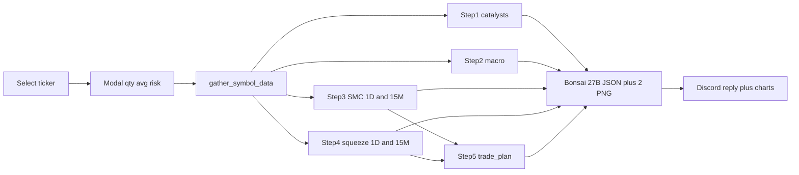

# תוכנית: פרוטוקול 5 השלבים בחדר ה-Analyst

## עיקרון מנחה

- **המספרים מחושבים בקוד, לא במודל.** רמות SMC, ערך Squeeze Momentum, גודל פוזיציה, Stop ו-TP מחושבים ב-Python. ה-LLM מנסח ומסיק מסקנה, ומעתיק את מספרי תוכנית הביצוע כלשונם.
- **צילומי TradingView לא נדרשים.** אנחנו כבר מושכים OHLC מ-yfinance, כבר יש [`smc.py`](smc.py) ו-[`chart_image.py`](chart_image.py). נרנדר בעצמנו גרף 1D וגרף 15M (נרות, שכבות SMC, תת-גרף Squeeze) ונשלח אותם ל-Bonsai 27B כתמונות (Vision), וגם נצרף ל-Discord. אין צורך בהעלאה ידנית.
- **אין בנייה מחדש.** משתמשים ב-`funda_client`, `news_client`, `market_data`, `confirmations`, `smc`, `signals.read_signals`, `llm_client`.

## מה כבר קיים ומה חסר

- **שלב 1 (זרזים):** יש `next_earnings` ו-`next_eps_estimate` ב-[`funda_client.py`](funda_client.py), יש `div_yield`, יש חדשות ב-[`news_client.py`](news_client.py). **חסר:** תאריך ex-dividend, אחוז שינוי יומי, גאפ, מחזור יחסי וסיווג Absorption/Distribution.
- **שלב 2 (מאקרו):** **חסר לגמרי.** אין QQQ, VIX, נפט וחדשות גיאופוליטיות.
- **שלב 3 (SMC):** יש ב-[`smc.py`](smc.py) swings, BOS/CHoCH, Order Blocks, FVG, EQH/EQL וסחף נזילות, אבל רק כשכבות ציור בקואורדינטות חלון של 30 נרות. **חסר:** Premium / Equilibrium / Discount, ובלוקים קרובים כמחירים מוחלטים.
- **שלב 4 (LazyBear):** **חסר.** צריך אינדיקטור Squeeze Momentum.
- **שלב 5 (ביצוע):** **חסר.** יש R:R 1:2 פשוט ב-`signalbot`, אבל אין Position Sizing, Stop לפי בלוק, TP1/TP2.
- **סטטוס תיק:** אין מקור (Alpaca paper מחזיק רק SPY). נוסיף Modal בדיסקורד.

## זרימה

## שינויים לפי קובץ

### אינטראקציה בדיסקורד: [`analystbot.py`](analystbot.py)
- ב-`AnalystSelect.callback`: אחרי בדיקות cooldown ו-inflight, קוראים `interaction.response.send_modal(HoldingModal(symbol))` (חובה כתגובה ראשונה, לכן ה-`defer` עובר ל-`on_submit`).
- `HoldingModal` עם 3 שדות אופציונליים: **כמות מניות**, **מחיר ממוצע**, **סיכון בדולרים** (ברירת מחדל מ-`ANALYST_RISK_USD`). שדות ריקים = כניסה חדשה במזומן. ולידציה: כמות ומחיר חייבים לבוא יחד, מספרים חיוביים.
- הלוגיקה הקיימת (`defer`, `gather`, `run_analysis`, שליחת chunks, טיפול בשגיאות) עוברת לפונקציית עזר משותפת שנקראת מ-`on_submit`. בנוסף מצרפים את שני ה-PNG כ-`discord.File`.

### אינדיקטורים חדשים
- **`squeeze.py` (חדש):** LazyBear Squeeze Momentum. Bollinger 20/2 מול Keltner 20/1.5 למצב squeeze. הערך הוא linreg(close − avg(avg(highest high, lowest low), SMA), 20). מחזיר ערך אחרון, צבע העמודה (ירוק בוהק / ירוק כהה / אדום כהה / ורוד), squeeze on/off, חציית אפס, ו"עמודה ירוקה בוהקת חדשה". משתמש ב-`ema`/`bollinger` מ-[`confirmations.py`](confirmations.py).
- **הרחבת [`smc.py`](smc.py):** פונקציה חדשה `snapshot_smc(df, radius)` שמחזירה מחירים מוחלטים: טווח swing אחרון, אזור Premium/Equilibrium/Discount (50% = equilibrium) ומיקום המחיר באחוזים, בלוק ביקוש והיצע קרובים שלא נשברו (מעל ומתחת למחיר), CHoCH/BOS אחרונים, EQL/EQH וסחף אחרון, FVG פתוחים, ו"קיר בטון" (בלוק היצע קרוב מעל, מרחק באחוזים). משתמשת שוב ב-`_structure_and_obs`, `_find_fvgs`, `_liquidity`. הלוגיקה הקיימת של `detect_smc` לא משתנה. ב-1D נשתמש ב-radius גדול יותר.

### הקשר שוק: `market_context.py` (חדש)
- דרך `market_data.fetch_yfinance_history`: **QQQ** (מגמה מול EMA 20/50/200, אזור Premium/Discount דרך `snapshot_smc`, שינוי יומי), **^VIX** (רמה, שינוי יומי ו-5 ימים), **CL=F ו-BZ=F** (נפט, שינוי יומי ו-5 ימים), **ESLT** (שינוי יומי כפרוקסי לרוטציה למניות ביטחון).
- **חדשות גיאופוליטיות:** פונקציית עזר קטנה ב-[`news_client.py`](news_client.py) שעוטפת את `_get_text` + `_parse_rss` הקיימים עם שאילתות Google News RSS (US Israel Iran military, oil prices). כותרות בלבד, וה-LLM שופט Risk-Off.
- Cache של כ-10 דקות (`MACRO_TTL_MIN`) כדי שמספר ניתוחים ברצף לא יציפו את yfinance. כישלון חלקי לא מפיל: השדה מסומן `n/a` וה-LLM מצהיר על פער.

### ביצוע: `trade_plan.py` (חדש)
- **קלט:** מחיר, `snapshot_smc` של 1D ו-15M, ATR, סיכון בדולרים, החזקה (אופציונלי).
- **Stop:** מתחת לבלוק הביקוש הקרוב ומתחת ל-Equilibrium (הנמוך מביניהם), פחות באפר קטן, ואז "שבירת העגול": ירידה למחיר שמסתיים ב-.80/.90 (לא במספר עגול), כדי להימנע מ-stop hunt.
- **Position Sizing:** `shares = floor(risk_usd / (entry − stop))`, כולל חישוב סיכון דולרי בפועל וגודל פוזיציה כולל.
- **TP1 (חצי כמות):** קצה בלוק ההיצע הקרוב. **TP2 (שארית):** היעד המבני הבא (בלוק Premium או swing high). מחושב R:R לכל יעד ולמשולב. אחרי TP1, Stop של החצי השני עובר למחיר הכניסה.
- **אם כבר מחזיקים:** מחזירים גם P/L נוכחי, מרחק ה-Stop ממחיר הממוצע, והאם ה-Stop כבר בנקודת אפס סיכון.
- **דגלי איכות:** TP1 עם R:R קטן מ-1, חסר בלוק היצע (נפילה ל-swing high), או Stop רחוק מדי יחסית ל-ATR. התוכנית מוצגת כ"אם הטריגר מתקיים" כשאין אישור.

### גרפים לתמונה: `analysis_charts.py` (חדש)
- רינדור 1D (כ-120 נרות) ו-15M (כ-120 נרות) באותו סגנון כהה של `chart_image.py`: נרות, שכבות SMC דרך `_draw_smc` הקיים, קווי Premium/EQ/Discount, ותת-גרף היסטוגרמה של Squeeze. QQQ לא מרונדר (רק מספרים).

### הרכבת הקשר ל-LLM: [`analyst_context.py`](analyst_context.py)
- `gather_symbol_data` מחזיר כעת בלוקים `step1` עד `step5` ובנוסף `holding`. הנתונים הקיימים (snapshot, חדשות, אותות אחרונים) נכנסים לתוך `step1` ו-"Signals" כך שלא הולכים לאיבוד. מושכים 1D (`2y`) ו-15M (`60d`) דרך `market_data.fetch_ohlcv_period`.
- שלב 1 מחשב: שינוי יומי, גאפ (open מול close קודם), מחזור יחסי (`confirmations.volume_ratio`), וסיווג Absorption/Distribution דטרמיניסטי לפי מחזור גבוה ומיקום הסגירה בטווח. ex-dividend מ-`yfinance` calendar בקריאה אחת עם fallback ל-`n/a`.
- **פרומפט חדש:** חמישה סעיפים בשמות השלבים + `Verdict` (GO / WAIT / AVOID עם confidence). הכללים: JSON בלבד, אין להמציא מספרים, מספרי שלב 5 מועתקים כלשונם, ללא disclaimers, ופער נתונים מצוין במפורש. אורך עד כ-650 מילים (ה-chunking ל-2000 תווים כבר קיים).
- **Vision:** [`llm_client.py`](llm_client.py) מקבל helper קטן שבונה חלק הודעה `image_url` (data URI). אם השרת דוחה תמונות, חוזרים אוטומטית לטקסט בלבד. מתג `ANALYST_VISION` (ברירת מחדל פעיל).

### קונפיגורציה ותיעוד
- [`config.py`](config.py) ו-[`.env.example`](.env.example): `ANALYST_RISK_USD`, `ANALYST_VISION`, `MACRO_TTL_MIN`.
- עדכון [`README.md`](README.md) (סעיף Fundi analyst room) ו-[`HANDSOFF.md`](HANDSOFF.md) (קבצים חדשים, זרימת Modal, משתני env).

## בדיקות
- `tests/test_squeeze.py`: סדרה סינתטית מחזירה צבע וחציית אפס נכונים ו-squeeze on/off.
- `tests/test_smc.py` (הרחבה): Premium/Discount על טווח ידוע, בלוק קרוב, קיר בטון.
- `tests/test_trade_plan.py`: חישוב sizing, "שבירת העגול", TP1/TP2, R:R, מצב החזקה מול מזומן, בלוק היצע חסר.
- `tests/test_market_context.py`: מוק ל-yfinance וכישלון חלקי.
- `tests/test_analystbot.py` ו-`tests/test_analyst_context.py` (הרחבה): ולידציית Modal, מבנה ההודעה עם תמונות ובלעדיהן.

## הנחות שאפשר לשנות לפני הבנייה
- **רק לונג.** הפרוטוקול כתוב לכיוון קנייה, ולכן אין ניתוח שורט.
- **קווי מגמה כתומים** לא מחושבים (לא ניתנים לזיהוי אמין בקוד). יעד TP2 נשען על בלוק Premium או swing high.
- **שבירת העגול:** ירידה ל-.80/.90 נעשית במחירים מסביב לדולר אחד ומעלה. למניות יקרות מאוד (מעל כ-200 דולר) נדרש צעד גדול יותר, אותו נגדיר בקוד.
- **Bonsai 27B איטי על המכונה הזו.** הניתוח עם שתי תמונות עלול לקחת דקות, ה-timeout הקיים הוא 600 שניות. אם זה כואב, מכבים עם `ANALYST_VISION=0`.
