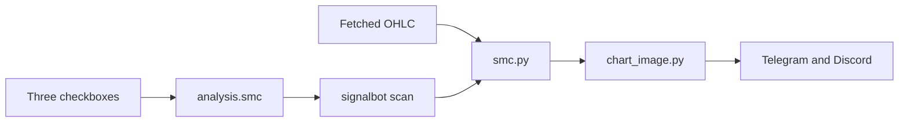

# Smart Money overlays on alert images

This is architectural: a new detector, a new slice of watchlist config, and a change to how alert PNGs are drawn. The existing alert path stays the same when all three boxes are off.

**שלוש תיבות סימון מתחת לציון המינימום.** כל אחת מוסיפה שכבה לתמונת ההתראה בלבד: אזורים, מבנה (BOS/CHoCH), או סחף נזילות. הציון והחסימה לא משתנים.

## Approaches

- **Own detector, separate from drawing (recommended).** New [`smc.py`](smc.py) reads the bars the bot already fetched and returns zones, labels, and lines. [`chart_image.py`](chart_image.py) only paints them. Unit tests can check the geometry without looking at pixels.
- **Logic inside `chart_image.py`.** Fewer files, but swing rules and matplotlib stay tangled, and the file is already the PNG renderer.
- **PyPI `smartmoneyconcepts`.** Extra dependency, and its marks will not match the three checkboxes or the 30-bar image.

## What the checkboxes do

They live in [`web/src/components/signals/analysis-field.tsx`](web/src/components/signals/analysis-field.tsx), inside Technical analysis, directly under the Minimum score toggle. They use a check mark (a new base-ui checkbox in `web/src/components/ui/checkbox.tsx`, Check icon from lucide), not the existing switches.

- **Zones** — order blocks and fair value gaps
- **Structure** — BOS and CHoCH labels
- **Liquidity** — equal highs/lows and the sweep through them

All three default off. Old `signal_config.json` files load as off. They show whenever confluence is on. If Block weak signals is off, Minimum score hides and the three boxes stay at the bottom of that section, so the overlay does not depend on blocking.

Saved on each watchlist as `analysis.smc`:

```json
{ "zones": false, "structure": false, "liquidity": false }
```

Touched for the flag: [`signals.py`](signals.py) (`default_analysis`, `_clean_analysis`), [`web/src/lib/schemas/signals.ts`](web/src/lib/schemas/signals.ts), the new-watchlist default in [`watchlist-form-card.tsx`](web/src/components/signals/watchlist-form-card.tsx).

## How a mark gets onto the image



[`signalbot.py`](signalbot.py) already calls `render_candles` once per alert (around line 318) and sends that PNG to both channels. Pass the three flags in. If every flag is false, the PNG is unchanged.

Detect on the full fetched frame (intraday lookback through `2y` / `5y` daily and weekly). Draw only marks that intersect the last 30 bars already plotted. Cap the drawing so the risk/reward boxes stay readable: last 2 unmitigated order blocks per side, last 2 unfilled fair value gaps per side, last 4 structure labels inside the window, last 2 liquidity levels.

Rules, fixed so the tests have one meaning:

- **Swing** — 5-bar fractal (high or low stricter than the two bars on each side).
- **BOS** — close beyond the last swing in the direction of the current leg.
- **CHoCH** — first close beyond the latest opposite swing.
- **Order block** — last opposite candle before that break. Rectangle is the candle body, extended right until price trades through it.
- **Fair value gap** — low of the third candle above the high of the first (bullish), or the mirror (bearish). Rectangle until filled.
- **Liquidity** — two swing highs or lows within 0.05% of each other. A sweep is a wick through that level and a close back inside. Horizontal line plus a mark on the sweep bar.

Colors stay in the existing dark palette in [`chart_image.py`](chart_image.py): teal boxes for bullish zones, red for bearish, amber labels for BOS/CHoCH, a muted line for liquidity. Pattern highlight and risk/reward boxes keep their current z-order on top.

A render failure still logs and sends the text alert with no photo, as it does today.

## Out of scope

No change to confluence score, required checks, or `filtered` rows. No SMC on the lab chart. No session killzones, premium/discount, or breaker blocks.

## Tests and docs

- [`tests/test_smc.py`](tests/test_smc.py): synthetic OHLC for one bullish FVG, one bullish order block after a BOS, one CHoCH, and one equal-high sweep. Flags off means those lists are empty.
- [`tests/test_chart_image.py`](tests/test_chart_image.py): PNG magic bytes still hold with each layer on, and with all layers off.
- [`tests/test_signals_config.py`](tests/test_signals_config.py): missing `smc` loads as all false; explicit trues round-trip.
- Update the `analysis` row in [`HANDSOFF.md`](HANDSOFF.md) and the technical-analysis paragraph in [`README.md`](README.md).
